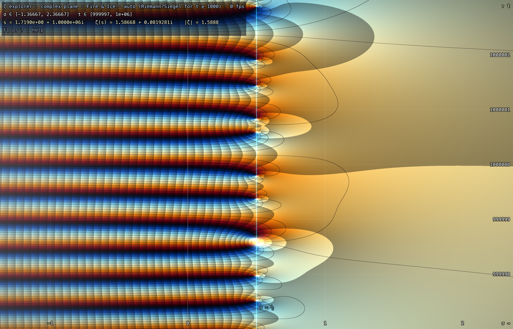
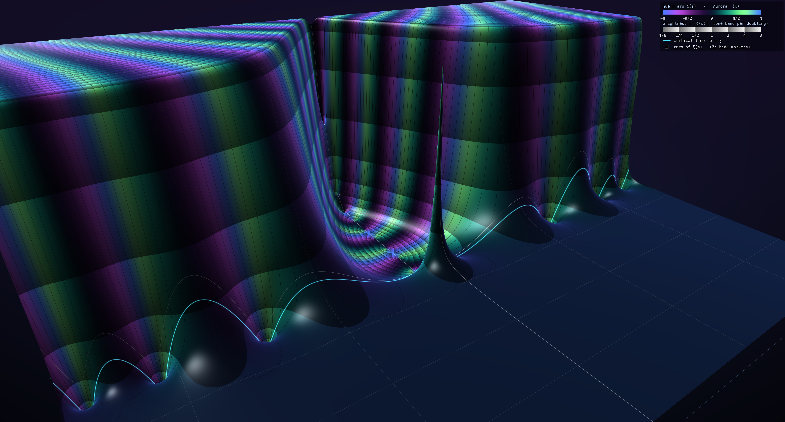
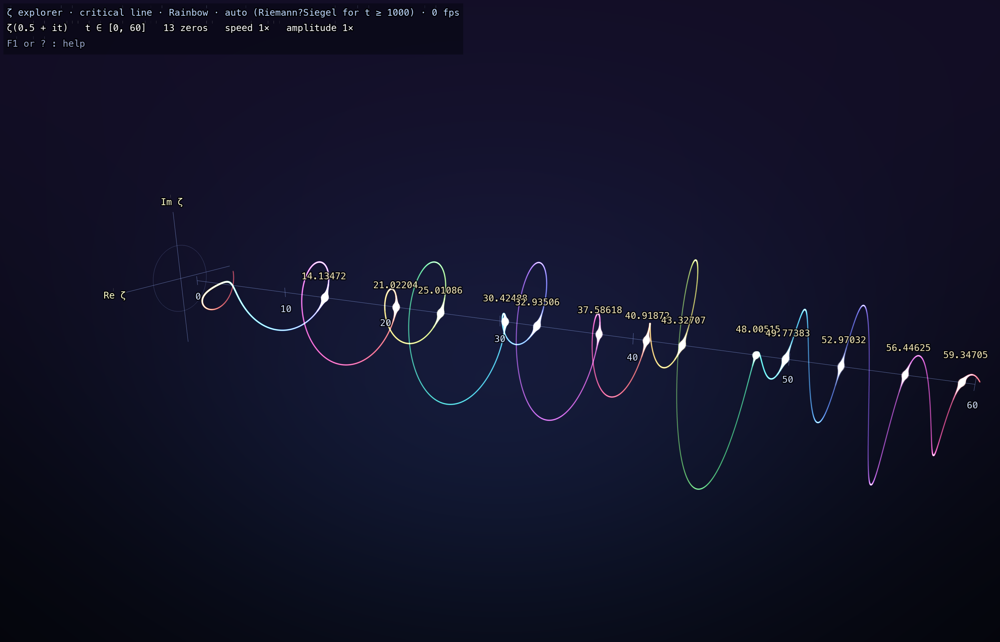
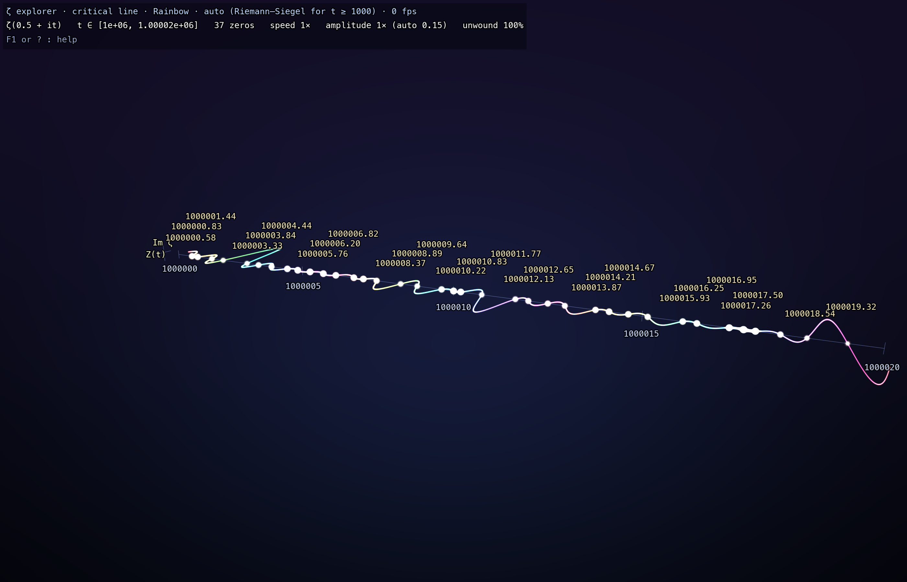

# ζ explorer: the Riemann zeta function on the GPU

An interactive 3D viewer for the Riemann zeta function ζ(s). Every value is computed live on the GPU
(OpenGL 4.1 shaders, driven from Python), from the trivial zeros near the origin up to heights of
t ≈ 10¹⁰ on the critical line.

| Complex plane (t ≈ 10⁶) | Landscape |
|---|---|
|  |  |
| **Critical line ζ(½ + it), 0 ≤ t ≤ 60** | **Hardy's Z(t) near t = 10⁶ (unwound)** |
|  |  |

---

## Running it

You need Python 3.10+ and a GPU with OpenGL 4.1. Any Mac from the last decade qualifies, as do
most Linux and Windows machines.

```bash
python3 -m venv .venv
.venv/bin/pip install -r requirements.txt     # moderngl, glfw, numpy, mpmath, pillow
.venv/bin/python zeta_viewer.py
```

Useful command-line options:

```bash
# start in the complex-plane view, centred at s = 1/2 + 10^6 i
.venv/bin/python zeta_viewer.py --mode 1 --center 0.5 1e6 --height 3

# the critical-line trace for 10^6 <= t <= 10^6 + 20, already unwound into Hardy's Z(t)
.venv/bin/python zeta_viewer.py --mode 3 --t 1e6 1.00002e6 --unwind

# other options: --scheme twilight, --animate, --camera 1 (end-on), --sigma 0.7,
#                --labels, --info (both off by default; toggle with L / I),
#                --style full|phase|modulus|lines, --colorbar, --no-markers (X / B / Z)
# render one frame to a PNG and exit
.venv/bin/python zeta_viewer.py --mode 2 --shot out.png
```

To check the GPU values against [mpmath](https://mpmath.org) at high precision:

```bash
.venv/bin/python test_zeta_gpu.py --quick
```

### The three views

| Key | View | What you see |
|---|---|---|
| `1` | **Complex plane** | Domain colouring of ζ over a region of s = σ + it. |
| `2` | **Landscape** | The same region drawn as a 3D surface, with height \|ζ\| or log\|ζ\| and colour arg ζ. |
| `3` | **Critical line** | The curve t ↦ ζ(σ + it), drawn in 3D as (t, Re ζ, Im ζ). |

Views 1 and 2 show the same region of the plane. You can navigate in the flat view and press `2`
to see that region as a surface.

### Controls

Press **?** in the window to show these keys (F1 also works).

| Key | Action |
|---|---|
| mouse drag / right-drag / scroll | pan or rotate / pan the camera / zoom |
| `1` `2` `3`, `Tab` | switch view |
| `space` | animate (phase flow, auto-rotate, the trace drawing itself) |
| `K` / `shift-K` | next / previous colour map (14; Aurora is the default): Rainbow, Neon, Twilight, Fire & Ice, Pastel, Monochrome, HSV, Phase, Ocean, Sunset, Aurora, Copper, Earth, Blue-Orange. All are cyclic, since phase wraps around |
| `X` / `shift-X` | display style: colour + brightness (default) / colour only (arg ζ) / brightness only (\|ζ\|) / lines only (contour lines on a neutral background, finer grid) |
| `B` | colour bar / legend (top right): labelled bars for hue (arg ζ) and brightness (\|ζ\|), or a line legend when colours are off |
| `Z` | zero markers on / off |
| `L` / `I` | axis labels / info panel (the panel shows ζ(s) under the cursor). Both start off; `--labels` and `--info` turn them on at launch |
| `T` | type a value of t, e.g. `1e6`, then Enter to jump there |
| `M` | method: auto / Euler–Maclaurin only / Riemann–Siegel only |
| `S` / `R` / `Esc` | screenshot (saved in `screenshots/`) / reset / quit |

**Plane and landscape:** the arrow keys and `[` `]` move and zoom the region. `N` / `P` jump to
the next or previous zero on the critical line. `A` cycles the aspect ratio: 1:1 (the default) → σ squeezed 2.5×
(same t range, more of σ) → t stretched 2.5× (same σ range, more of t) → back to 1:1. `C` toggles contour lines and `G` the grid.
In the landscape, `H` switches the height between |ζ| and log|ζ|, and `-` / `=` scale it.

**Critical line:**

| Key | Action |
|---|---|
| `←` `→` | scroll the t-window |
| `[` `]` | widen / narrow the t-window |
| `↑` `↓` / `0` | change σ / go back to σ = ½ |
| `U` | unwind into Hardy's Z(t) |
| `V` | camera preset: side, end-on, top, front |
| `-` `=` | amplitude |
| `,` `.` | animation speed |

---

## The mathematics

### The function

For Re(s) > 1 the zeta function is the convergent series

$$\zeta(s) = \sum_{n=1}^{\infty} \frac{1}{n^{s}} = \prod_{p\ \text{prime}} \frac{1}{1-p^{-s}},$$

and analytic continuation extends it to every s ≠ 1. At s = 1 it has a simple pole.
The **functional equation**

$$\zeta(s) = \chi(s)\,\zeta(1-s), \qquad \chi(s) = 2^{s}\pi^{s-1}\sin\!\left(\frac{\pi s}{2}\right)\Gamma(1-s)$$

relates values on either side of the **critical line** Re(s) = ½. The zeros are of two kinds:

* the *trivial zeros* at s = −2, −4, −6, … (from the sine factor), visible as a row of black
  dots on the negative real axis in view 1;
* the *non-trivial zeros* in the critical strip 0 < Re(s) < 1. The **Riemann Hypothesis**
  states that all of them lie on Re(s) = ½. Every zero you will find in this program does:
  each one is a black dot on the cyan line.

### Hardy's Z function

On the critical line one can write

$$\zeta(\tfrac12 + it) = e^{-i\theta(t)}\, Z(t),\qquad
\theta(t) = \arg\Gamma\!\left(\tfrac14 + \tfrac{it}{2}\right) - \tfrac{t}{2}\log\pi,$$

where θ is the Riemann–Siegel theta function and **Z(t) is real**. In view 3 the trace
ζ(½ + it) winds around the origin and touches it exactly at the zeros. Pressing `U` multiplies by
e^{iθ(t)}, which rotates every point of the curve back onto the real axis: the spiral collapses
into the flat wave Z(t). The zeros of ζ on the line become the sign changes of Z. The program finds
the zeros it labels from those sign changes in the GPU-computed samples, refined by linear
interpolation.

### Reading the pictures

**Domain colouring (view 1).** Each point s gets a colour from ζ(s):

* **Hue = arg ζ(s).** In the Rainbow scheme, red means ζ is a positive real number and cyan means it
  is a negative real number. A zero is a point where every colour meets, cycling once around it in one
  direction. The pole at s = 1 is where the colours cycle the other way.
* **Brightness bands = log₂|ζ(s)|.** Each band ramps from dark to bright as |ζ| doubles, then drops
  back at the next power of 2. Press `X` to see either quantity on its own: *colour only* shows just
  the phase, *brightness only* shows just |ζ| as grey bands. The thin dark lines are
  curves of constant phase, every 30°.
* Zeros are drawn as small dark markers, a few pixels wide at any zoom. `Z` hides them; the zeros
  are still visible as the points where all colours meet and the brightness bands crowd together.
  Very large values fade towards white.
* The default 1:1 aspect ratio shows that ζ is *conformal*: away from zeros and the pole, the phase
  lines and the |ζ| contours always cross at right angles.
* `B` shows a colour bar that labels these encodings. `X` removes the colours entirely and shows only
  the dark phase lines, grey |ζ| contours and a finer grid.
* Far to the right ζ ≈ 1, so the plane goes flat and uniform. Far to the left |ζ| grows
  factorially, so the bands crowd together.
* With `space` the bands and phase lines flow outward from the zeros.

**Landscape (view 2).** The height is |ζ(s)|. It is softly capped as 6(1 − e^{−|ζ|/6}) so the
pole and the left half-plane don't dominate. With `H` the height becomes log|ζ| instead, where
zeros become deep wells. Zeros are the points where the surface touches the floor, all along the
cyan critical line.

### How ζ is computed (in float32, on the GPU)

Each pixel or vertex runs a fragment shader in [zeta_core.py](zeta_core.py). GPUs work in 32-bit
floats, with about 7 significant digits, so the methods below are arranged to keep that precision.

#### 1. Euler–Maclaurin summation (|t| < 1000)

$$\zeta(s) = \sum_{n=1}^{N-1} n^{-s} + \frac{N^{1-s}}{s-1} + \frac{N^{-s}}{2}
+ \sum_{k=1}^{8} \frac{B_{2k}}{(2k)!}\, s(s+1)\cdots(s+2k-2)\, N^{-s-2k+1}$$

* B₂ₖ are the Bernoulli numbers, and the shader uses N = ⌊8 + 0.4|s|⌋.
* The correction terms shrink roughly like (|s|/2πN)^{2k}, so this choice of N keeps the
  truncation error below float precision.
* The cost is O(|s|) terms per point.

For Re(s) < ½ the shader evaluates ζ(1 − s) instead and applies the functional equation:

* It works with logarithms throughout: log χ(s) = s log 2 + (s−1) log π + log sin(πs/2) + log Γ(1−s).
* log sin is evaluated in an overflow-safe form, and log Γ uses Stirling's series after shifting
  the argument by 8.
* The output is the pair (log|ζ|, arg ζ). This stays finite even where |ζ| ~ 10⁵⁰ deep in the
  left half-plane.

#### 2. Riemann–Siegel formula (t ≥ 1000)

Euler–Maclaurin needs about 0.4·t terms, which is too many at large t. The Riemann–Siegel
formula, in the general form valid off the critical line too (Arias de Reyna 2011), needs only
about √(t/2π):

$$\zeta(s) = R(s) + \chi(s)\,\overline{R(1-\bar s)},\qquad
R(s) = \sum_{n=1}^{N} n^{-s} + (-1)^{N-1}\, U\, a^{-\sigma}\, F(p) + \dots$$

with

$$a = \sqrt{t/2\pi},\quad N = \lfloor a\rfloor,\quad p = 1 - 2(a-N),\quad U = e^{-i\theta_0(t)},$$

$$F(p) = \frac{e^{\pi i (p^2/2 + 3/8)} - i\sqrt2\,\cos(\pi p/2)}{2\cos(\pi p)}.$$

* The program keeps only the first correction term, F(p). F has removable singularities at
  p = ±½, which the shader handles by interpolation.
* On the critical line this reduces to the classical Riemann–Siegel formula
  Z(t) = 2Σ n^{-1/2} cos(θ − t log n) + (−1)^{N−1}(2π/t)^{1/4} C₀(p), with
  C₀ = cos 2π(p² − p − 1/16) / cos 2πp, written in the classical variable p = a − N.
* For large t the χ factor comes from its asymptotic expansion,

$$\log\chi(\sigma+it) = -2i\,\theta_0(t) + (\tfrac12-\sigma)\log\tfrac{t}{2\pi} + \sigma
- (s-\tfrac12)\log\!\left(1-\tfrac{i\sigma}{t}\right) - \frac{1}{12s} + \frac{1}{360s^3} + \dots,$$

  with θ₀(t) = (t/2) log(t/2π) − t/2 − π/8. Every term except the phase θ₀ is small and safe in float32.

#### 3. The precision trick: CPU-supplied phases

At t = 10⁶ a float32 cannot even resolve t to better than 0.06, so computing t·log n directly
would give meaningless phases. Instead:

1. The CPU picks a reference height t_ref near the view. It computes, in double precision (or
   mpmath above 10⁸), the table φₙ = (t_ref · log n) mod 2π for every n needed, together with
   θ₀(t_ref) mod 2π and a₀ = √(t_ref/2π).
2. The table is uploaded as a texture. Each pixel only handles the small offset d = t − t_ref:
   n^{−it} = e^{−i(φₙ + d·log n)}, and θ₀(t_ref + d) − θ₀(t_ref) is computed with a careful log1p.
3. The table is rebuilt whenever the view moves too far from t_ref.

This is the same idea as "camera-relative rendering" in large game worlds.

#### Accuracy

Results of `test_zeta_gpu.py`, which compares the GPU against mpmath. Errors are in log|ζ|,
i.e. relative error of |ζ|.

| region | method | median error | max error |
|---|---|---|---|
| σ ∈ [−12, 4], t ∈ [−2, 42] | Euler–Maclaurin | 2e-6 | 1e-5 |
| σ ∈ [−30, −20] (\|ζ\| up to 10³⁰) | EM + functional equation | 6e-6 | 3e-5 |
| t ≈ 1 000 | Riemann–Siegel | 4e-5 | 2e-4 |
| t ≈ 10⁶ (also t ≈ −10⁶) | Riemann–Siegel | 7e-7 | 4e-6 |
| t ≈ 10⁸ | Riemann–Siegel | 1e-6 | 4e-6 |
| t ≈ 10¹⁰ | Riemann–Siegel | 4e-6 | 3e-5 |

The Riemann–Siegel truncation error falls off like t^{−(σ+1)/2}. Near t = 1000 the two methods are
comparably accurate, so that is where the automatic switch happens (`RS_THRESHOLD` in
`zeta_core.py`).

### Performance

* **Cost per point:** about 0.4|s| terms below t = 1000, and about 2√(t/2π) above. That is
  roughly 800 terms at t = 10⁶ and 80 000 at t = 10¹⁰.
* **Progressive refinement:** results are cached in float textures and only recomputed when the
  view changes. The work is spread over frames under a fixed per-frame budget, so the window stays
  responsive: a coarse image appears first, then sharpens.
* **Zero jumping:** the `N` / `P` keys use mpmath on the CPU (`siegelz` plus a root finder).

---

## Files

| File | Contents |
|---|---|
| `zeta_viewer.py` | the application: windows, views, shaders for drawing, text, controls |
| `zeta_core.py` | GLSL implementation of ζ (Euler–Maclaurin, Riemann–Siegel, log Γ, θ) and the CPU phase table |
| `test_zeta_gpu.py` | runs the GPU code offscreen and compares it with mpmath |
| `docs/` | screenshots used above |

## References

* H. M. Edwards, *Riemann's Zeta Function*, Academic Press (1974). Covers the Riemann–Siegel
  formula, Euler–Maclaurin summation and Gram points.
* J. Arias de Reyna, "High precision computation of Riemann's zeta function by the
  Riemann–Siegel formula, I", *Math. Comp.* **80** (2011), 995–1009.
* E. Wegert, *Visual Complex Functions: An Introduction with Phase Portraits*, Birkhäuser (2012).
  Covers domain colouring and phase portraits.
* A. M. Odlyzko and A. Schönhage, "Fast algorithms for multiple evaluations of the Riemann zeta
  function", *Trans. AMS* **309** (1988).

## License

MIT, see [LICENSE](LICENSE).
