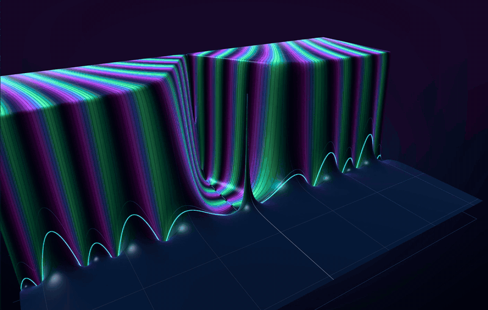
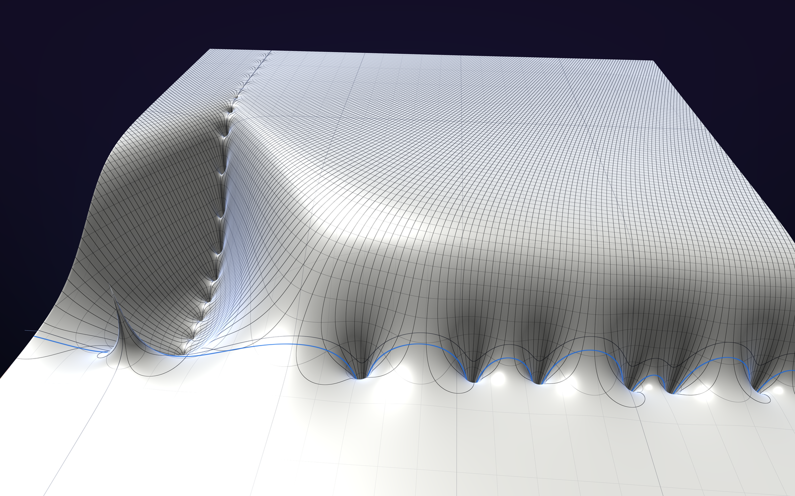

# ζ function

The Riemann zeta function, computed live on the GPU. Rotate it, zoom into it, follow its zeros
from the origin to t = 10¹⁰.

**[▶ Open it in your browser](https://delaossa.github.io/zeta/)**.



## What you are looking at

The landscape is ζ(s) over a patch of the complex plane, s = σ + it. Height is its magnitude |ζ(s)|, colour is
its phase arg ζ(s).

- The **cyan line** is the critical line, σ = ½. Every point where the surface touches the floor
  is a non-trivial zero. The Riemann Hypothesis says every one of them lies on this line.
- The dark dots running left along t = 0 are the trivial zeros, at s = −2, −4, −6, …
- The **spike** is the pole at s = 1.
- To the right ζ flattens out towards 1. To the left it grows into a wall.


*The same landscape with colours off (`X`) and log|ζ| as height (`H`): the zeros become wells.*

## Play with it

- **Drag** to rotate, **scroll** or **pinch** to zoom.
- **1 2 3** switch views: the complex plane (the landscape seen from above, as a flat colour map),
  the landscape, and the critical line (ζ(½ + it) traced as a curve in 3D, crossing the axis at
  every zero).
- **N / P** hop from zero to zero along the critical line.
- **T** takes you to any height: try 1e6, or 1e10.
- **X** changes the style (colour, brightness, lines), **K** cycles through 14 colour maps, and
  **B** shows a legend.
- **Space** sets everything in motion, and **F** goes fullscreen.
- On the critical line, **U** unwinds the spiral into Hardy's real function Z(t).
- **?** lists every key. On a touchscreen, the toolbar and the pad in the corner do the same.

## Run it on your computer

The desktop version needs Python 3.10+ and a GPU with OpenGL 4.1 (any recent Mac, most PCs):

```bash
python3 -m venv .venv
.venv/bin/pip install -r requirements.txt
.venv/bin/python zeta_viewer.py
```

**S** saves a screenshot to `screenshots/`. The browser version also runs offline: open
`web/index.html`.

## How it works

Near the origin ζ is summed with Euler–Maclaurin. Higher up the Riemann–Siegel formula takes over,
and the CPU supplies precomputed phases so the GPU's 32-bit floats keep about five digits even at
t = 10¹⁰. The details, with formulas and accuracy tests, are in **[the mathematics](docs/MATH.md)**.

## License

MIT, see [LICENSE](LICENSE).
